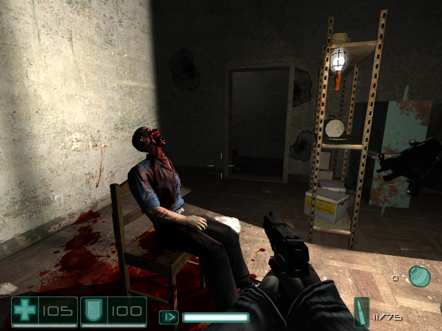

# F.E.A.R. source port

Reverse engineering and source-port work for **F.E.A.R.** (Jupiter Ex, 2005), built on top of
the Lithtech engine source tree.

The primary goal is not to write a look-alike from scratch. The goal is to recover the original
engine behavior from the shipped `EngineServer.dll`, `GameServer.dll` and the retail client
image, then reproduce it in source with measurable visual parity.



*F.E.A.R. first mission reference frame. The visual target is the retail 1.08.282 renderer,
HUD and weapon presentation, not a reinterpretation.*

## Status

The project has reached the first-mission startup milestone:

- the source-built v5 client runs through the v4 `Lithtech.exe` with the existing client facade;
- a retail v5 `EngineServer.dll` + `GameServer.dll` bootstrap can load
  `Worlds\Release\Intro`;
- the client and server now exchange the real connection, start-level, player-state and
  InWorld messages;
- the client reaches `GS_PLAYING` with a live server-side player in `Worlds\Release\Intro`.

This is a startup milestone, not a finished playable mission. The player camera is now attached
to the server player and renders the v113 world through the v5 renderer callback; the interface
manager also draws the HUD. The world is batched by material and 455 `.Mat00` textures are
decoded and uploaded from the staged archives. Object replication, local-player movement,
weapons, models, lightmaps, `.fxo` shaders, shadows and the remaining HUD state are still not
restored. The object-dependent messages are filtered until the v5 database records and server
object handles are mapped to the client.

| Area | Current state |
|---|---|
| Client + v5 facade | Builds and runs |
| LTAR v3 staging | Works |
| v5 server bootstrap | Works |
| First mission startup | `GS_PLAYING`, player Alive, `Worlds\Release\Intro` |
| Player camera | Wired to the server player transform |
| Camera projection | Uses the client's `SetCameraFOV` values (91.3° x 75.0° at 1024x768) |
| Local player character | Character FX created, `MODL` data still stubbed |
| Playable movement / collision | Not yet |
| HUD / weapons | HUD draws; weapons and player values incomplete |
| v113 renderer | Table-driven vertex decoding, `CCW` culling, 1988/1988 world objects parsed; lightmaps and shadows missing |
| 95% visual parity | Not yet measured or reached |
| Parity measurement | `tools/parity_check.py` (SSIM, CIEDE2000, channel tolerance) |
| Source-only v5 server | Not yet |

## Architecture

```text
Lithtech.exe (v4)
  └─ CShell.dll
      └─ FearHost.dll
          ├─ GameClient.dll        source-built v5 client
          ├─ GameServer.dll        retail v5 server game code
          └─ EngineServer.dll      retail v5 server engine
```

The two generations are deliberately separated: the v4 engine owns the host and the source
client, while the retail v5 server stays in its native MSVC 7.1 world. The bridge uses only
interfaces with POD/handle arguments and raw messages. This keeps the v5 renderer path open
without pretending that the v4 and v5 engine databases and object layouts are interchangeable.

The retail `EngineServer.dll` and `GameServer.dll` are currently a bootstrap for reaching the
first mission. They are not the final source-only server. Internal offsets and the
`IsMultiplayerExe` patch are isolated in `FEAR/Compat/v5host/fear_server_host.cpp` and must be
replaced by a source-side `IServerShell`/`ILTServer` implementation.

## Reverse engineering

The reverse-engineering workspace and IDA databases live outside this repository:

- `D:\fear-re\re\ida\work\EngineServer.dll.i64`
- `D:\fear-re\re\ida\decompiled-full`
- `D:\fear-re\re\ida\decompiled-gameserver`

The work uses IDA Pro 9.3 headless with the published corpus workflow. Findings are validated
against build `1.08.282`; offsets are not assumed to be portable. The current investigation
covers:

- the v5 local client record (`0x60` bytes), connection state and `OnAddClient` /
  `OnClientEnterWorld` callbacks;
- `MID_*` game-message encoding and the server/client connection state machine;
- the v113 world render section, material table and shadow-volume split;
- `.Mat00`/`.fxo`, `.Model00p`, DDS and animation formats;
- the retail client image as a visual and behavioral reference. The client image is packed;
  runtime capture and RenderDoc/DXVK are used instead of assuming static addresses.

Every recovered behavior should have an address, a decompiled function, a source location or a
measured asset-format result behind it. Plausible invented behavior is not acceptance evidence.

## Building

Windows, Debug x86 is the default development configuration:

```powershell
.\tools\build_windows.ps1 -Configuration Debug
```

Build the source `GameClient.dll` against the Public Tools SDK:

```powershell
.\tools\build_fear_client.ps1 `
  -PublicToolsDir "D:\SteamLibrary\steamapps\common\FEAR Ultimate Shooter Edition\FEAR Public Tools 1.08"
```

The F.E.A.R. port is an isolated CMake configuration (`BUILD_FEAR_PORT=ON`) and writes its
artifacts to `build-fear/OUT_FEAR`. See `BUILD_WINDOWS.md` for toolchain, DirectX SDK and SDL2
requirements.

## Running

Stage a writable run directory from the retail installation:

```powershell
.\tools\run_fear_port.ps1 `
  -RetailDir "D:\SteamLibrary\steamapps\common\FEAR Ultimate Shooter Edition" `
  -GameClientDll "build-fear-client\GameClient.dll"
```

For deterministic startup tests, set `FEAR_AUTOSTART=1`; this drives `StartGameNew` without
menu input. `tools/run_on_desktop.ps1` can launch the stage on a separate Win32 desktop when a
visible interactive desktop is needed.

A local development machine currently needs a DXVK `d3d9.dll` in the staging directory because
its native D3D9 `CreateDevice` path reports `D3DERR_DEVICELOST`; DXVK is a test workaround only
and is not part of the repository or the final runtime.

## Repository map

| Path | Purpose |
|---|---|
| `FEAR/Compat/v5host` | v5 client facade, server bootstrap, message bridge |
| `FEAR/Compat/cshell` | v4-to-v5 host proxy and v113 world preview |
| `FEAR/Compat/publictools_client` | source-client exports and startup/preload hooks |
| `runtime` | Lithtech engine |
| `tools` | build, stage, desktop, inspection and parity scripts |
| `tools/parity_check.py` | visual parity metrics: channel tolerance, MAE, SSIM, CIEDE2000 |
| `docs/FEAR_PORT_PLAN.md` | architecture, milestones and reverse-engineering log |
| `docs/FEAR_ACCEPTANCE.md` | first-mission and visual-parity acceptance gates |
| `BUILD_WINDOWS.md` | Windows build and staging instructions |

## Next work

1. Capture a retail reference frame of Interval 01 at a fixed camera and run
   `tools/parity_check.py` against the port frame, so the parity gap stops being an estimate.
2. Restore v113 static lighting. The object section is now fully decoded: FEAR XORs the eight world
   model counters with 399, and each object record frames a `uint16`-prefixed class name, a
   property count, a blob and four payload bytes per property. The C++ parser reads all 1988 objects
   in `Intro.World00p` and recovers 35 point, 12 spot, 2 directional and 39 cube lights plus
   `AmbientLight=(25,25,25)`. The missing term is the material lightmap stage, not the light list.
3. Port the MODL 33 model loader, animation and HUD services, using the retail renderer as the
   reference. This also clears the `no Null weightset on Character` error.
4. Restore `.fxo` shaders, fog, shadow volumes and post-processing on top of the material and DDS
   texture path that already works.
5. Map the v5 database records and server object handles to client-side objects, then remove the
   safe-message filter and finish movement, collisions, weapons and HUD values.
6. Replace the retail server bootstrap with a source-side v5 server.

## Provenance

This repository contains engine code derived from the GPL release of the Jupiter Ex engine, with
additional game code and port work. F.E.A.R. retail assets, archives and engine binaries are not
distributed with this repository; they are used locally as a reference against an owned
installation.
